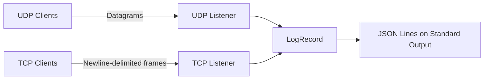

# UDP/TCP Log Collector

A containerized log transport service that collects raw log messages over UDP and TCP while preserving the original payload and socket peer address.

This milestone focuses exclusively on reliable transport and collection. Log parsing, persistence, APIs, visualization, correlation rules, and alerting are planned as separate project stages.

## Features

* Listens for UDP and TCP traffic simultaneously
* Uses the same configurable port number for both protocols
* Preserves raw log bytes without parsing or normalization
* Records the source IP and source port from the socket connection
* Supports multiple concurrent TCP clients
* Isolates TCP client failures from other active connections
* Uses newline-delimited framing for TCP messages
* Produces structured JSON records on standard output
* Provides lossless Base64 representation of each payload
* Shuts down cleanly on `SIGINT` and `SIGTERM`
* Runs as a non-root user inside Docker
* Starts through Docker Compose
* Includes local and container-level integration tests

## Architecture



UDP datagrams are treated as individual log records. TCP is a byte stream, so a newline character marks the end of each log record.

## Log Record Format

Each received log is emitted as a JSON object:

```json
{
  "received_at": "2026-08-18T07:44:48.939865+00:00",
  "protocol": "UDP",
  "source_ip": "172.19.0.1",
  "source_port": 59669,
  "raw_log_text": "container-udp-test",
  "raw_log_base64": "Y29udGFpbmVyLXVkcC10ZXN0",
  "raw_log_size": 18
}
```

| Field            | Description                                          |
| ---------------- | ---------------------------------------------------- |
| `received_at`    | UTC timestamp recorded when the payload is received  |
| `protocol`       | Transport protocol, either `UDP` or `TCP`            |
| `source_ip`      | Actual peer IP reported by the socket                |
| `source_port`    | Actual peer port reported by the socket              |
| `raw_log_text`   | Human-readable UTF-8 representation                  |
| `raw_log_base64` | Lossless Base64 representation of the original bytes |
| `raw_log_size`   | Original payload size in bytes                       |

`raw_log_text` is provided for readability. `raw_log_base64` is the lossless representation and must be used when the original bytes need to be reconstructed exactly.

## Requirements

For local execution:

* Python 3.12 or newer

For container execution:

* Docker
* Docker Compose

## Local Installation

Clone the repository:

```powershell
git clone https://github.com/BeyzaBirben/udp-tcp-log-collector.git
Set-Location udp-tcp-log-collector
```

Create and activate a virtual environment on Windows:

```powershell
python -m venv .venv
.\.venv\Scripts\Activate.ps1
```

On Linux or macOS:

```bash
python3 -m venv .venv
source .venv/bin/activate
```

Install the project in editable mode:

```powershell
python -m pip install --editable .
```

## Running Locally

Start the UDP and TCP listeners:

```powershell
log-collector --host 0.0.0.0 --udp-port 5514 --tcp-port 5514
```

Use `127.0.0.1` instead of `0.0.0.0` when the service should accept traffic only from the local machine.

Stop the application with `Ctrl+C`.

## Running with Docker Compose

Build and start the service:

```powershell
docker compose up --build -d
```

Check its state:

```powershell
docker compose ps
```

Follow collector output:

```powershell
docker compose logs -f collector
```

The Compose configuration publishes both transports:

* `5514/tcp`
* `5514/udp`

Stop the container:

```powershell
docker compose stop
```

Remove the container and Compose network:

```powershell
docker compose down
```

The local application and Docker container cannot listen on the same host ports at the same time.

## Sending UDP Traffic

Send one UDP log:

```powershell
python scripts\send_udp.py --message "CEF:0|TestVendor|TestProduct|1.0|100|UDP test|1|clientId=udp-001"
```

Send multiple UDP logs:

```powershell
python scripts\send_udp.py --message "UDP load test" --count 5
```

## Sending TCP Traffic

Send one TCP log:

```powershell
python scripts\send_tcp.py --message "CEF:0|TestVendor|TestProduct|1.0|200|TCP test|1|clientId=tcp-001"
```

Send multiple logs over one TCP connection:

```powershell
python scripts\send_tcp.py --message "TCP test" --count 5
```

Each TCP message is terminated with a newline before transmission.

## TCP Load Generator

Run one client:

```powershell
python scripts\tcp_load.py --clients 1 --messages-per-client 1
```

Run five concurrent clients:

```powershell
python scripts\tcp_load.py --clients 5 --messages-per-client 1
```

Run twenty concurrent clients:

```powershell
python scripts\tcp_load.py --clients 20 --messages-per-client 1
```

Disconnect client 3 after its first complete message:

```powershell
python scripts\tcp_load.py --clients 5 --messages-per-client 2 --disconnect-client 3 --disconnect-after 1
```

The load generator prints a JSON summary containing client identifiers, local source addresses, completed message counts, and disconnected clients.

## Standard Integration Tests

Run the socket-level integration tests:

```powershell
python -m unittest discover -s tests -v
```

These tests run without starting Docker. Container tests are skipped unless they are explicitly enabled.

## Container Integration Tests

Ensure Docker Desktop or the Docker Engine is running.

On PowerShell:

```powershell
$env:RUN_CONTAINER_TESTS = "1"
python -m unittest tests.integration.test_containerized_collector -v
Remove-Item Env:RUN_CONTAINER_TESTS
```

On Linux or macOS:

```bash
RUN_CONTAINER_TESTS=1 python -m unittest tests.integration.test_containerized_collector -v
```

The container test suite manages its own lifecycle. It builds the image, starts the collector, sends real network traffic from outside the container, validates the results, and removes the test container and network.

## Test Coverage

| Scenario                | Verification                                                       |
| ----------------------- | ------------------------------------------------------------------ |
| Single UDP packet       | Raw bytes, protocol, source IP, source port, and Base64 round-trip |
| Concurrent TCP clients  | 1, 5, and 20 simultaneous client connections                       |
| Client disconnection    | Remaining TCP clients continue after one connection is aborted     |
| Simultaneous transports | UDP and TCP traffic are processed at the same time                 |
| Container traffic       | Real host-to-container UDP and TCP traffic                         |
| Graceful shutdown       | Listener shutdown messages and exit code `0`                       |
| Port release            | TCP and UDP ports can be bound again after shutdown                |
| Restart                 | Container restarts on the same ports and processes new traffic     |

## Project Structure

```text
.
├── scripts
│   ├── send_tcp.py
│   ├── send_udp.py
│   └── tcp_load.py
├── src
│   └── log_collector
│       ├── __init__.py
│       ├── __main__.py
│       ├── models.py
│       ├── tcp_server.py
│       └── udp_server.py
├── tests
│   └── integration
│       ├── test_containerized_collector.py
│       ├── test_transport_concurrency.py
│       └── test_udp_listener.py
├── .dockerignore
├── Dockerfile
├── compose.yaml
├── pyproject.toml
└── README.md
```

## Design Decisions

### Raw payload preservation

The transport layer does not parse or modify the received log. Original bytes are retained and represented through Base64 when serialized to JSON.

### Socket peer address

The collector uses the address reported by the UDP datagram or TCP connection. It does not trust an IP address written inside the log payload.

When traffic passes through Docker Desktop, the collector may see the Docker network gateway address instead of `127.0.0.1`. This is the actual peer address visible from inside the container.

### TCP connection isolation

Every TCP connection is handled independently. An error or abrupt disconnection in one client does not terminate the listener or interrupt other connected clients.

### TCP framing

TCP does not preserve message boundaries. The collector therefore treats each newline-delimited frame as one log record. The framing newline is transport metadata and is not included in the stored raw payload.

### Graceful shutdown

The application handles termination signals, closes active TCP clients, stops both listeners, and releases their ports before exiting.

### Container security

The Docker image runs the application as the unprivileged `collector` user. Port `5514` is used so the process does not require privileged port access.

## Current Milestone Boundary

This milestone establishes the collection and transport layer. The following capabilities belong to later milestones:

* Log parsing and normalization
* Message broker integration
* Database persistence
* Query API
* Web or mobile visualization
* Correlation rules
* Alert generation
