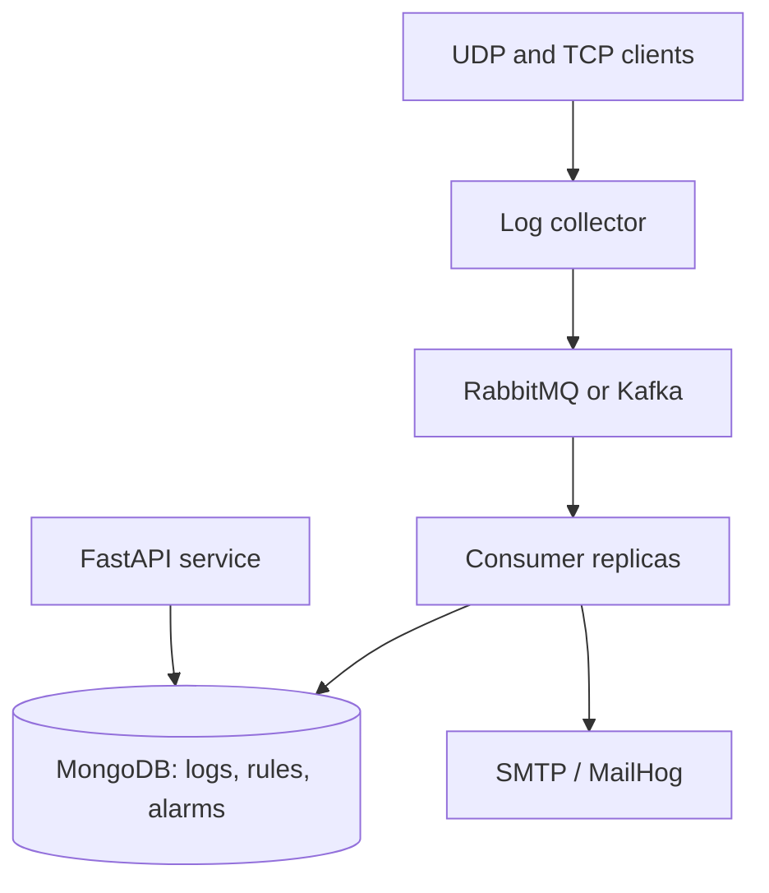

# UDP/TCP Log Collection and Correlation Pipeline

A containerized log pipeline that receives raw messages over UDP and TCP, publishes them through RabbitMQ or Kafka, and persists them to MongoDB through independently scalable consumers. A FastAPI service exposes logs, source summaries, correlation rules, and alarms. Matching rules create durable alarms and can send email notifications asynchronously through SMTP.

The pipeline preserves the original payload and socket peer metadata without parsing or normalization. Broker selection is configuration-driven and does not require source-code changes.

## Features

- Listens for UDP and TCP traffic simultaneously on the same configurable port number
- Preserves raw bytes, source IP, source port, protocol, and receive timestamp
- Uses newline-delimited framing for TCP messages
- Supports multiple concurrent TCP clients without cross-client failure propagation
- Selects RabbitMQ or Kafka through `BROKER_PROVIDER`
- Keeps transport listeners independent from broker implementations
- Publishes persistent, confirmed messages to RabbitMQ
- Uses acknowledged, idempotent production with Kafka
- Runs a separate consumer service that writes batches to MongoDB
- Acknowledges broker messages only after a successful database write
- Uses idempotent MongoDB upserts to prevent duplicate persistence
- Scales the consumer service to multiple replicas
- Reconnects after broker, collector, or consumer interruptions
- Exposes paginated log and source queries through a separate FastAPI service
- Stores configurable correlation rules in MongoDB
- Supports `contains`, `equals`, `startsWith`, and `regex` rule operators
- Reloads enabled rules without restarting consumer replicas
- Persists alarms with references to the triggering rule and log
- Sends alarm email asynchronously without blocking log persistence
- Isolates rule, alarm, and SMTP failures from the broker processing loop
- Includes MailHog for local SMTP inspection
- Starts the complete stack through Docker Compose
- Includes unit, socket, container, real-pipeline, recovery, correlation, API, load, scaling, and benchmark coverage

## Architecture



The collector never writes directly to MongoDB. Every persisted log follows this path:

```text
UDP/TCP -> Collector -> Broker -> Consumer -> MongoDB
```

After persistence, each consumer evaluates its cached active rules. A match creates an alarm and optionally queues an email. The API reads MongoDB independently from the collector and consumer processes.

| Component | Responsibility |
| --- | --- |
| UDP listener | Treats each datagram as one raw log record |
| TCP listener | Treats each newline-delimited frame as one raw log record |
| Collector publisher | Converts transport records to broker messages and retries failed publishing |
| RabbitMQ or Kafka | Buffers and distributes messages independently from the collector |
| Consumer | Receives broker messages in batches and coordinates persistence acknowledgements |
| MongoDB repository | Performs durable, idempotent batch upserts |
| Correlation engine | Reloads active rules and evaluates every persisted log |
| Alarm handler | Stores rule matches and queues optional email notifications |
| Log API | Queries logs and sources and manages rules and alarms |
| SMTP or MailHog | Receives alarm email without blocking the consumer |

## Delivery Model

The collector preserves every payload it receives, including non-UTF-8 byte sequences. Human-readable text is included for inspection, while Base64 and BSON binary fields preserve the original bytes exactly.

RabbitMQ uses durable queues, persistent messages, publisher confirmations, manual consumer acknowledgements, and requeue-on-failure behavior.

Kafka uses `acks=all`, an idempotent producer, three topic partitions, consumer groups, manual offset commits, and offset rewind on processing failure.

MongoDB uses majority and journaled writes. Each message UUID is also the MongoDB document identifier, and repeated broker deliveries use an idempotent upsert rather than creating duplicate documents.

UDP itself does not provide delivery acknowledgements or transport-level retransmission. The benchmark therefore uses controlled UDP pacing to avoid overflowing the Docker Desktop forwarding path while measuring the complete application pipeline.

## Broker Message Format

Every broker message contains a schema version, unique message identifier, transport metadata, and two representations of the original payload:

```json
{
  "schemaVersion": 1,
  "messageId": "6ef5b79d-27ae-43f6-b934-3aa596932e36",
  "receivedAt": "2026-08-29T10:35:56.123456Z",
  "protocol": "UDP",
  "sourceIp": "172.19.0.1",
  "sourcePort": 59669,
  "rawLog": "container-udp-test",
  "rawLogBase64": "Y29udGFpbmVyLXVkcC10ZXN0",
  "rawLogSize": 18
}
```

| Field | Description |
| --- | --- |
| `schemaVersion` | Message-contract version, currently `1` |
| `messageId` | UUID retained across publish retries and broker redelivery |
| `receivedAt` | UTC timestamp captured when the collector received the log |
| `protocol` | `UDP` or `TCP` |
| `sourceIp` | Peer IP reported by the socket |
| `sourcePort` | Peer port reported by the socket |
| `rawLog` | Readable UTF-8 representation with replacement for invalid sequences |
| `rawLogBase64` | Lossless Base64 representation of the original bytes |
| `rawLogSize` | Original payload size in bytes |

MongoDB stores the same fields and adds `rawLogBytes` as BSON binary data. The document `_id` equals `messageId`.

## Requirements

For local execution:

- Python 3.12 or newer

For the complete pipeline:

- Docker Desktop or Docker Engine
- Docker Compose v2

## Local Installation

Clone the repository:

```powershell
git clone https://github.com/BeyzaBirben/udp-tcp-log-collector.git
Set-Location udp-tcp-log-collector
```

Create and activate a virtual environment on Windows:

```powershell
python -m venv .venv
.\.venv\Scripts\Activate.ps1
```

On Linux or macOS:

```bash
python3 -m venv .venv
source .venv/bin/activate
```

Install the project in editable mode:

```powershell
python -m pip install --editable .
```

## Running the Transport Layer Locally

Run the listeners with structured standard output and no external broker requirement:

```powershell
log-collector --host 0.0.0.0 --udp-port 5514 --tcp-port 5514
```

Use `127.0.0.1` instead of `0.0.0.0` when traffic should be accepted only from the local machine. Stop the process with `Ctrl+C`.

## Running the Complete Pipeline

RabbitMQ is the default provider. Set it explicitly and start the stack:

```powershell
$env:BROKER_PROVIDER = "rabbitmq"
docker compose up --build -d
```

Start the Kafka stack without changing application code:

```powershell
docker compose down --remove-orphans
$env:BROKER_PROVIDER = "kafka"
docker compose up --build -d
```

Inspect the services:

```powershell
docker compose ps -a
```

Open the local interfaces after every service is healthy:

| Interface | Address |
| --- | --- |
| OpenAPI documentation | `http://127.0.0.1:8000/docs` |
| API health | `http://127.0.0.1:8000/health` |
| MailHog inbox | `http://127.0.0.1:8025` |
| RabbitMQ management | `http://127.0.0.1:15672` |

Follow application logs:

```powershell
docker compose logs -f collector consumer
```

Scale the consumer service to three replicas:

```powershell
docker compose up -d --scale consumer=3
```

Stop the complete stack while preserving named volumes:

```powershell
docker compose down --remove-orphans
```

Clear the provider variable when it is no longer needed:

```powershell
Remove-Item Env:BROKER_PROVIDER
```

The local application and Docker collector cannot bind the same host ports at the same time.

## Docker Compose Services

| Service | Image or command | Purpose |
| --- | --- | --- |
| `collector` | `log-collector` | Receives UDP/TCP and publishes to the selected broker |
| `consumer` | `log-consumer` | Consumes batches and writes to MongoDB |
| `api` | `log-api` | Exposes logs, sources, rules, alarms, and health endpoints |
| `broker` | RabbitMQ 4 or Kafka 4.3 | Selected message broker |
| `database` | MongoDB 8 | Durable raw-log persistence |
| `mailhog` | MailHog 1.0.1 | Captures local alarm email for inspection |
| `kafka-init` | Kafka image | Initializes Kafka volume permissions and then exits |

The collector publishes both `5514/tcp` and `5514/udp`. The API, MailHog, MongoDB, and broker administration ports are bound to localhost.

## Core Configuration

| Variable | Default | Purpose |
| --- | --- | --- |
| `BROKER_PROVIDER` | `rabbitmq` | Selects `rabbitmq` or `kafka` |
| `RABBITMQ_QUEUE` | `raw-logs` | Durable RabbitMQ queue name |
| `KAFKA_TOPIC` | `raw-logs` | Kafka topic name |
| `KAFKA_CONSUMER_GROUP` | `log-consumers` | Kafka consumer group |
| `BROKER_RECONNECT_DELAY_SECONDS` | `1.0` | Delay between reconnect attempts |
| `COLLECTOR_PUBLISH_WORKERS` | `8` | Concurrent broker publishing workers |
| `COLLECTOR_MAX_PENDING_MESSAGES` | `0` | In-memory queue limit; `0` is unbounded |
| `COLLECTOR_STDOUT_ENABLED` | `true` | Enables structured collector output |
| `CONSUMER_BATCH_SIZE` | `500` | Maximum messages per database batch |
| `CONSUMER_BATCH_TIMEOUT_SECONDS` | `1.0` | Maximum wait for a consumer batch |
| `MONGODB_DATABASE` | `log_collection` | MongoDB database name |
| `MONGODB_COLLECTION` | `raw_logs` | MongoDB collection name |
| `MONGODB_RULES_COLLECTION` | `correlation_rules` | Correlation-rule collection name |
| `MONGODB_ALARMS_COLLECTION` | `alarms` | Alarm collection name |
| `API_PORT` | `8000` | Host port for the FastAPI service |
| `API_DEFAULT_PAGE_SIZE` | `50` | Default API result page size |
| `API_MAX_PAGE_SIZE` | `200` | Maximum API result page size |
| `CORRELATION_ENABLED` | `true` | Enables consumer-side rule evaluation |
| `CORRELATION_RULE_REFRESH_SECONDS` | `1.0` | Active-rule cache refresh interval |
| `SMTP_HOST` | `mailhog` | SMTP server hostname |
| `SMTP_PORT` | `1025` | SMTP server port |
| `SMTP_FROM` | `alerts@log-collector.local` | Alarm sender address |
| `SMTP_USERNAME` | empty | Optional SMTP username |
| `SMTP_PASSWORD` | empty | Optional SMTP password |
| `SMTP_USE_TLS` | `false` | Enables SMTP STARTTLS |
| `SMTP_TIMEOUT_SECONDS` | `5.0` | SMTP operation timeout |

## Log Query API

The API runs as a process separate from the collector and consumers. Interactive request schemas and validation details are available through Swagger UI at `http://127.0.0.1:8000/docs`.

| Method | Endpoint | Purpose |
| --- | --- | --- |
| `GET` | `/health` | Check API and MongoDB repository health |
| `GET` | `/api/logs` | Query logs by required `from` and `to`, optional `sourceIp` and `q`, then paginate |
| `GET` | `/api/logs/{id}` | Get one log by UUID |
| `GET` | `/api/sources` | List source IP, log count, first-seen, and last-seen summaries |
| `GET` | `/api/sources/{sourceIp}/logs` | Query logs for one exact source IP |

Time parameters must be ISO 8601 values with a timezone. Results are ordered by receive time descending, and every paginated response includes `items`, `page`, `pageSize`, and `total`.

Query logs from PowerShell:

```powershell
$from = [uri]::EscapeDataString("2026-08-29T00:00:00Z")
$to = [uri]::EscapeDataString("2026-08-30T00:00:00Z")
Invoke-RestMethod "http://127.0.0.1:8000/api/logs?from=$from&to=$to&page=1&pageSize=50"
```

## Correlation Rules

Rules are stored in MongoDB and managed without restarting the stack.

| Method | Endpoint | Purpose |
| --- | --- | --- |
| `GET` | `/api/rules` | List rules |
| `POST` | `/api/rules` | Create a rule |
| `GET` | `/api/rules/{id}` | Get one rule |
| `PUT` | `/api/rules/{id}` | Replace a rule |
| `DELETE` | `/api/rules/{id}` | Delete a rule |

Each rule targets an exact source IP already present in collected logs. Conditions use the `rawLog` or `sourceIp` field and the `contains`, `equals`, `startsWith`, or `regex` operator. Every condition must match for the rule to fire.

Example request body:

```json
{
  "name": "Repeated authentication failure",
  "enabled": true,
  "sourceIp": "172.19.0.1",
  "conditions": [
    {
      "field": "rawLog",
      "operator": "contains",
      "value": "authentication failed"
    }
  ],
  "actions": ["Alarm", "Email"],
  "emailTo": ["security@example.com"]
}
```

The API rejects unknown fields, invalid IP addresses, empty condition sets, invalid regular expressions, duplicate actions or recipients, unsupported fields or operators, missing email recipients, and source IP addresses that do not yet exist in the log collection.

## Alarms and Email

| Method | Endpoint | Purpose |
| --- | --- | --- |
| `GET` | `/api/alarms` | Query alarms with optional `from`, `to`, `ruleId`, and `sourceIp` filters |
| `GET` | `/api/alarms/{id}` | Get one alarm together with its triggering log |

An alarm stores the rule ID and name, source IP, triggering log ID, raw log, creation time, and `emailSent` state. The alarm is written before email delivery is queued. SMTP work runs on a background task; a delivery failure leaves `emailSent` as `false` and does not stop log persistence, broker acknowledgement, or later correlation.

## Sending UDP Traffic

Send one UDP log:

```powershell
python scripts\send_udp.py --message "CEF:0|TestVendor|TestProduct|1.0|100|UDP test|1|clientId=udp-001"
```

Send multiple UDP logs:

```powershell
python scripts\send_udp.py --message "UDP load test" --count 5
```

## Sending TCP Traffic

Send one TCP log:

```powershell
python scripts\send_tcp.py --message "CEF:0|TestVendor|TestProduct|1.0|200|TCP test|1|clientId=tcp-001"
```

Send multiple logs over one TCP connection:

```powershell
python scripts\send_tcp.py --message "TCP test" --count 5
```

Each TCP message is terminated with a newline before transmission. The framing newline is transport metadata and is not stored in the raw payload.

## TCP Load Generator

Run 1, 5, or 20 concurrent clients:

```powershell
python scripts\tcp_load.py --clients 1 --messages-per-client 1
python scripts\tcp_load.py --clients 5 --messages-per-client 1
python scripts\tcp_load.py --clients 20 --messages-per-client 1
```

Disconnect client 3 after its first complete message:

```powershell
python scripts\tcp_load.py --clients 5 --messages-per-client 2 --disconnect-client 3 --disconnect-after 1
```

## Standard Test Suite

Run the unit and socket-level integration tests:

```powershell
python -m unittest discover -s tests -v
```

The verified suite contains 343 tests. With Docker-backed suites disabled, 24 opt-in tests are skipped.

## Container Integration Tests

```powershell
$env:RUN_CONTAINER_TESTS = "1"
python -m unittest tests.integration.test_containerized_collector -v
Remove-Item Env:RUN_CONTAINER_TESTS
```

## Real Broker Pipeline Tests

Run the same five scenarios against RabbitMQ and Kafka:

```powershell
$env:RUN_PIPELINE_TESTS = "1"
$env:BROKER_PROVIDER = "rabbitmq"
python -m unittest tests.integration.test_broker_pipeline -v
$env:BROKER_PROVIDER = "kafka"
python -m unittest tests.integration.test_broker_pipeline -v
Remove-Item Env:RUN_PIPELINE_TESTS
Remove-Item Env:BROKER_PROVIDER
```

These tests verify:

- Lossless UDP persistence with complete metadata
- Lossless TCP persistence
- Concurrent UDP and TCP processing
- 1, 5, and 20 concurrent TCP clients
- Three consumer replicas without duplicate MongoDB documents

## Recovery Tests

Run the four interruption scenarios against both providers:

```powershell
$env:RUN_RECOVERY_TESTS = "1"
$env:BROKER_PROVIDER = "rabbitmq"
python -m unittest tests.integration.test_broker_recovery -v
$env:BROKER_PROVIDER = "kafka"
python -m unittest tests.integration.test_broker_recovery -v
Remove-Item Env:RUN_RECOVERY_TESTS
Remove-Item Env:BROKER_PROVIDER
```

The recovery suite verifies that:

- Messages wait in the broker while the consumer is stopped
- The collector reconnects after a broker restart without uncontrolled termination
- Restarting the collector does not interrupt the broker or consumer
- Pending messages survive a consumer restart and persist without duplicates

## Week Three Integration Tests

Run the API, correlation, alarm, and email scenarios against both providers:

```powershell
$env:RUN_WEEK_THREE_TESTS = "1"
$env:BROKER_PROVIDER = "rabbitmq"
python -m unittest tests.integration.test_week_three_integration -v
$env:BROKER_PROVIDER = "kafka"
python -m unittest tests.integration.test_week_three_integration -v
Remove-Item Env:RUN_WEEK_THREE_TESTS
Remove-Item Env:BROKER_PROVIDER
```

The eight scenarios per provider verify matching and non-matching logs, exact source isolation, disabled rules, rule hot reload, invalid-rule rejection, SMTP failure isolation, API filters, source summaries, and stable pagination.

## Week Three Load and Scaling Tests

Run the 20-client correlation workload with one and three consumers:

```powershell
$env:RUN_WEEK_THREE_LOAD_TESTS = "1"
$env:BROKER_PROVIDER = "rabbitmq"
python -m unittest tests.integration.test_week_three_load_scaling -v
$env:BROKER_PROVIDER = "kafka"
python -m unittest tests.integration.test_week_three_load_scaling -v
Remove-Item Env:RUN_WEEK_THREE_LOAD_TESTS
Remove-Item Env:BROKER_PROVIDER
```

Each scenario sends 20,000 TCP logs through 20 concurrent clients and deliberately makes exactly 50 logs match one rule. All four provider/consumer-count runs persisted all 20,000 logs and created exactly 50 alarms.

| Provider | Consumers | Logs | Alarms | End-to-end (s) | Logs/s |
| --- | ---: | ---: | ---: | ---: | ---: |
| RabbitMQ | 1 | 20,000 | 50 | 4.015 | 4,981.029 |
| RabbitMQ | 3 | 20,000 | 50 | 6.108 | 3,274.493 |
| Kafka | 1 | 20,000 | 50 | 16.497 | 1,212.374 |
| Kafka | 3 | 20,000 | 50 | 16.032 | 1,247.518 |

These local Docker measurements validate correctness under load and consumer scaling. They are not universal broker capacity results. Full requirement traceability and interpretation are documented in [`docs/week-three-results.md`](docs/week-three-results.md).

## Benchmark

The benchmark manages the Compose lifecycle, creates isolated broker destinations, sends real host-to-container traffic, validates MongoDB contents, and samples Docker CPU and memory usage.

Run the default 20-client workload:

```powershell
python scripts\pipeline_benchmark.py --provider rabbitmq
python scripts\pipeline_benchmark.py --provider kafka
```

Run the constant 25,000-log workload with 1, 5, and 20 TCP clients:

```powershell
python scripts\pipeline_benchmark.py --provider rabbitmq --tcp-clients 1 --skip-build
python scripts\pipeline_benchmark.py --provider rabbitmq --tcp-clients 5 --skip-build
python scripts\pipeline_benchmark.py --provider rabbitmq --tcp-clients 20 --skip-build
python scripts\pipeline_benchmark.py --provider kafka --tcp-clients 1 --skip-build
python scripts\pipeline_benchmark.py --provider kafka --tcp-clients 5 --skip-build
python scripts\pipeline_benchmark.py --provider kafka --tcp-clients 20 --skip-build
```

### Benchmark Method

- 20,000 TCP logs divided across the selected number of clients
- 5,000 UDP logs sent at 250 messages per second with a burst size of 1
- 25,000 total unique logs
- Three consumer replicas
- Consumer batch size of 500
- Collector standard output disabled during measurement
- Docker resource sampling for collector, broker, consumers, and MongoDB
- Exact payload, protocol, message-ID, missing-record, and duplicate validation

### Results

All six final runs persisted exactly 25,000 of 25,000 records.

| Provider | TCP clients | Duration (s) | Logs/s | Average CPU (%) | Average memory (MiB) |
| --- | ---: | ---: | ---: | ---: | ---: |
| RabbitMQ | 1 | 20.181 | 1,238.786 | 773.649 | 793.019 |
| RabbitMQ | 5 | 20.238 | 1,235.280 | 729.134 | 621.504 |
| RabbitMQ | 20 | 21.111 | 1,184.200 | 776.598 | 615.145 |
| Kafka | 1 | 23.990 | 1,042.109 | 495.899 | 1,057.601 |
| Kafka | 5 | 24.296 | 1,028.966 | 548.237 | 1,019.961 |
| Kafka | 20 | 24.388 | 1,025.080 | 527.862 | 923.063 |

CPU values are summed Docker service averages and may exceed 100 percent because Docker reports multi-core CPU usage. Memory values are summed service averages for the complete stack.

Under this controlled workload, RabbitMQ produced 15.5 to 20.1 percent higher end-to-end throughput. It used more aggregate CPU, while Kafka used more aggregate memory. These measurements describe this Compose topology and host environment; they are not universal broker performance claims.

Raw benchmark data is stored under [`benchmark-results`](benchmark-results). The detailed methodology and acceptance evidence are documented in [`docs/week-two-results.md`](docs/week-two-results.md).

## Test Coverage Summary

| Requirement | Evidence |
| --- | --- |
| UDP through broker to MongoDB | Real pipeline test passes with exact bytes and metadata |
| TCP through broker to MongoDB | Real pipeline test passes for every sent frame |
| Concurrent UDP and TCP | Both transports persist without blocking each other |
| Multiple TCP clients | 1, 5, and 20 client scenarios pass |
| Consumer unavailable | Messages remain pending and persist after restart |
| Broker unavailable | Collector remains active and reconnects |
| Collector restart | Broker and consumer remain independent |
| Consumer restart | Pending messages persist without duplicates |
| Batch insertion | Consumer uses MongoDB bulk writes with batches up to 500 |
| Three consumers | Scaling test persists each unique message exactly once |
| RabbitMQ and Kafka | The same application and test suites pass with both providers |
| 25,000-log benchmark | Six client/provider combinations persist all records |
| Log and source API | Time, source, text, detail, aggregation, and pagination tests pass |
| Rule CRUD and validation | MongoDB-backed create, list, detail, replace, and delete tests pass |
| Rule hot reload | Updated behavior takes effect without restarting consumers |
| Correlation isolation | Non-matches, other sources, and disabled rules create no alarms |
| Durable alarms | Matches store the required rule, source, log, raw text, time, and email state |
| Asynchronous email | MailHog receives matching alerts; SMTP failure does not stop the pipeline |
| 20,000-log correlation load | Both providers persist every log and create exactly 50 alarms |
| Three-consumer correlation | Both providers retain the exact 50-alarm result when scaled |

## Project Structure

| Path | Contents |
| --- | --- |
| `src/log_collector/broker/` | RabbitMQ and Kafka producer/consumer implementations |
| `src/log_collector/api/` | FastAPI routes, request/response models, and MongoDB query repositories |
| `src/log_collector/correlation.py` | Rule cache, compilation, matching, and hot refresh |
| `src/log_collector/alarm.py` | Correlation-match to alarm workflow |
| `src/log_collector/email_delivery.py` | Asynchronous SMTP queue and sender |
| `src/log_collector/consumer.py` | Broker consumption, persistence, correlation, and acknowledgement flow |
| `tests/unit/` | Isolated transport, broker, API, rule, alarm, correlation, and email tests |
| `tests/integration/` | Socket, container, pipeline, recovery, Week Three, load, and scaling suites |
| `scripts/` | Traffic generators and Week Two benchmark runner |
| `benchmark-results/` | Preserved Week Two benchmark measurements and diagnostics |
| `docs/` | Milestone result reports and requirement traceability |
| `compose.yaml` | Shared collector, consumer, API, MailHog, and MongoDB services |
| `compose.rabbitmq.yaml` | RabbitMQ broker extension |
| `compose.kafka.yaml` | Kafka broker extension |

## Design Decisions

### Raw payload preservation

The transport layer does not parse or normalize received logs. Base64 and BSON binary values preserve original bytes even when a payload is not valid UTF-8.

### Socket peer address

The collector records the address reported by the socket and does not trust an IP address embedded in a payload. Through Docker Desktop, the visible peer may be the Docker network gateway rather than `127.0.0.1`.

### Broker abstraction

Transport listeners submit provider-independent messages. Broker factories select RabbitMQ or Kafka from configuration, so listeners and MongoDB persistence do not change when the provider changes.

### Backpressure and recovery

The collector queues records for asynchronous publishing and retries the same message identifier after transient broker failures. A configurable pending-message limit can be used when bounded memory is preferred.

### Database acknowledgement order

Consumers acknowledge RabbitMQ deliveries or commit Kafka offsets only after MongoDB confirms the batch. Failed writes cause requeue or offset rewind.

### Duplicate protection

MongoDB upserts use `messageId` as `_id`, supported by a unique message-ID index. Broker redelivery therefore does not create a second document.

### Rule cache and scaling

Each consumer replica periodically loads enabled rules from MongoDB and evaluates its own broker deliveries. Rule updates become visible after the configurable refresh interval, so scaling does not require shared in-memory state or a restart.

### Correlation failure isolation

Log persistence completes before correlation runs. A malformed stored rule, rule refresh failure, alarm write failure, or SMTP error is logged and isolated so the consumer can acknowledge persisted logs and continue processing later batches.

### Alarm-first email delivery

The consumer writes the alarm before placing email work on an in-process asynchronous queue. Successful SMTP delivery changes `emailSent` to `true`; failure preserves the alarm with `emailSent` set to `false`.

### Container security and lifecycle

Application containers run as an unprivileged user. Health checks, named volumes, restart policies, initialization, and graceful stop periods are defined through Compose.

## Current Milestone Boundary

The first three milestones are complete: transport collection, broker-backed persistence, recovery and benchmarking, log query APIs, source summaries, correlation-rule management, streaming correlation, durable alarms, asynchronous SMTP email, and one/three-consumer load validation.

Potential later stages include:

- Log parsing and normalization
- Web or mobile visualization
- Authentication and authorization
- Production observability and deployment hardening
