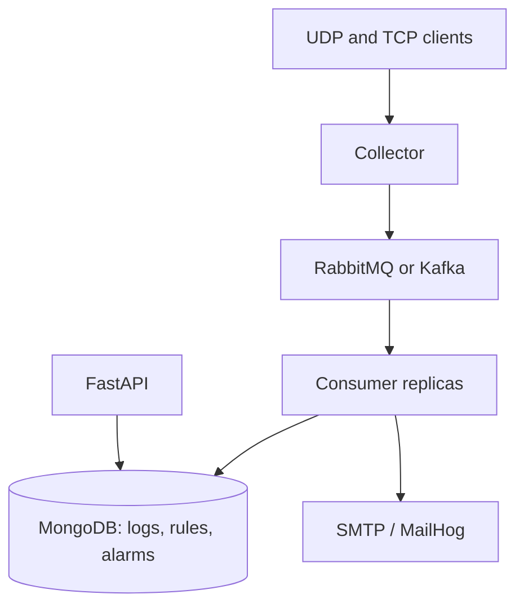

# Week Three - Log API, Correlation, Alarms, and Email

## Purpose

The third milestone extends the broker-backed log pipeline with four operational capabilities:

1. Query persisted logs and source summaries through a separate HTTP API.
2. Create and manage source-specific correlation rules without restarting services.
3. Evaluate enabled rules in the streaming consumer and persist alarms.
4. Deliver optional alarm email asynchronously while keeping log processing independent from SMTP availability.

The implementation supports the same RabbitMQ and Kafka providers used in Week Two.

## Final Architecture



The collector is responsible only for transport reception and broker publishing. Consumers persist each batch before evaluating correlation rules. The API and MailHog are separate Compose services and do not share the collector or consumer process lifecycle.

## Implementation Summary

### Log and source API

The `log-api` entry point runs FastAPI with an asynchronous MongoDB query repository. Log queries require an inclusive time range and support exact source-IP filtering, case-insensitive literal text search, deterministic descending ordering, pagination, and total counts.

The API returns the original readable and lossless payload representations. MongoDB BSON binary data is Base64-encoded for JSON transport.

Source summaries are calculated in MongoDB and return each source IP with its total log count, first receive time, and last receive time.

### Correlation rule management

Rules are stored in the `correlation_rules` collection by default. The API provides create, list, detail, replace, and delete operations.

A rule contains:

| Field | Meaning |
| --- | --- |
| `id` | Server-generated UUID |
| `name` | Human-readable rule name |
| `enabled` | Whether consumers should load the rule |
| `sourceIp` | Exact source IP to which the rule applies |
| `conditions` | One or more conditions evaluated with AND semantics |
| `actions` | Unique `Alarm` and/or `Email` actions |
| `emailTo` | Unique recipients required by the `Email` action |
| `createdAt` | UTC creation time |
| `updatedAt` | UTC last-update time |

Supported condition fields are `rawLog` and `sourceIp`. Supported operators are `contains`, `equals`, `startsWith`, and `regex`.

The API rejects invalid IP addresses, sources not yet observed in collected logs, empty rules, unsupported fields or operators, invalid regular expressions, duplicate actions, duplicate recipients, missing email recipients, and unknown request fields.

### Streaming correlation

Each consumer replica maintains its own immutable cache of compiled, enabled rules. It refreshes that cache from MongoDB at the configured interval, which is one second by default. A rule update therefore changes stream behavior without restarting the collector, broker, API, or consumers.

For every persisted broker message, the engine first checks the rule's exact `sourceIp` and then requires every condition to match. Consumer replicas are stateless with respect to each other; broker distribution determines which replica evaluates a message.

Rule refresh and evaluation failures are logged and isolated. A bad stored rule is skipped, and a temporary rule-store failure leaves the last successfully loaded cache available.

### Alarm persistence

A successful match creates a document in the `alarms` collection with the following fields:

| Field | Meaning |
| --- | --- |
| `_id` | Alarm UUID |
| `ruleId` | Matching rule UUID |
| `ruleName` | Rule name captured at match time |
| `sourceIp` | Source IP of the triggering log |
| `logId` | Triggering log UUID |
| `rawLog` | Readable triggering payload |
| `createdAt` | UTC alarm creation time |
| `emailSent` | Whether SMTP delivery completed successfully |

Alarm writes use majority and journaled MongoDB write concern. Indexes support descending time queries and filtered queries by rule or source.

### Asynchronous email

The alarm is stored before email work is queued. SMTP I/O runs outside the event-loop thread through an asynchronous background dispatcher. Successful delivery updates `emailSent` to `true`.

If SMTP is unavailable, the exception is logged and the alarm remains stored with `emailSent` set to `false`. The consumer continues persisting logs, evaluating later messages, and acknowledging successfully persisted broker deliveries.

MailHog provides a local SMTP server and browser inbox for repeatable integration tests. Production SMTP credentials and STARTTLS are configuration-driven.

### Compose topology

The shared Compose stack now contains:

| Service | Responsibility | Local port |
| --- | --- | ---: |
| `collector` | UDP/TCP reception and broker publishing | `5514/tcp`, `5514/udp` |
| `consumer` | Batch persistence, correlation, alarms, and email queueing | none |
| `api` | Logs, sources, rules, alarms, OpenAPI, and health | `8000` |
| `broker` | RabbitMQ or Kafka | provider-specific |
| `database` | Logs, rules, and alarms | `27017` |
| `mailhog` | SMTP capture and local inbox | `1025`, `8025` |

The API, MongoDB, MailHog, and broker administration endpoints bind to localhost. The collector remains reachable through its configured TCP and UDP host port.

## API Contract

| Method | Path | Inputs | Result |
| --- | --- | --- | --- |
| `GET` | `/health` | none | API and repository health |
| `GET` | `/api/logs` | required `from`, `to`; optional `sourceIp`, `q`, `page`, `pageSize` | Paginated logs and total |
| `GET` | `/api/logs/{id}` | log UUID | One log or `404` |
| `GET` | `/api/sources` | none | Source summaries |
| `GET` | `/api/sources/{sourceIp}/logs` | required `from`, `to`; optional `q`, `page`, `pageSize` | Paginated source logs |
| `GET` | `/api/rules` | none | All rules |
| `POST` | `/api/rules` | rule body | Created rule or `422` |
| `GET` | `/api/rules/{id}` | rule UUID | One rule or `404` |
| `PUT` | `/api/rules/{id}` | complete replacement body | Updated rule or `404`/`422` |
| `DELETE` | `/api/rules/{id}` | rule UUID | `204` or `404` |
| `GET` | `/api/alarms` | optional `from`, `to`, `ruleId`, `sourceIp`, `page`, `pageSize` | Paginated alarms and total |
| `GET` | `/api/alarms/{id}` | alarm UUID | Alarm plus triggering log, or `404` |

Time values must include a timezone. The API normalizes them to UTC. Log results use `receivedAt` descending and alarm results use `createdAt` descending, with `_id` as a stable secondary sort key.

The default page size is 50 and the configured maximum is 200.

## Example Rule

```json
{
  "name": "SSH login failure",
  "enabled": true,
  "sourceIp": "172.19.0.1",
  "conditions": [
    {
      "field": "rawLog",
      "operator": "contains",
      "value": "login failed"
    },
    {
      "field": "sourceIp",
      "operator": "equals",
      "value": "172.19.0.1"
    }
  ],
  "actions": ["Alarm", "Email"],
  "emailTo": ["soc@example.com"]
}
```

This rule fires only when the socket-observed source is `172.19.0.1` and both conditions match. The source-IP condition is deliberately evaluated in addition to the rule's required source scope.

## Requirement Traceability

| Requirement | Status | Evidence |
| --- | --- | --- |
| Separate log API | Complete | `log-api` runs independently and has its own Compose service |
| Time-range log query | Complete | `from` and `to` are required, timezone-aware, inclusive, and validated |
| Source-IP log filter | Complete | Exact IPv4/IPv6 filtering is implemented and tested |
| Raw-log text search | Complete | `q` performs escaped, case-insensitive literal matching |
| Descending order and total | Complete | MongoDB facet returns ordered items and total in one query |
| Maximum pagination size | Complete | Configurable default 50 and maximum 200 are enforced |
| Log detail endpoint | Complete | UUID lookup returns one complete persisted log |
| Source summary endpoint | Complete | MongoDB aggregation returns count, first-seen, and last-seen values |
| Per-source log endpoint | Complete | Exact source path plus time, text, and pagination filters is implemented |
| Rule CRUD | Complete | Create, list, detail, replace, and delete endpoints use MongoDB |
| Source existence validation | Complete | Rule writes reject source IPs absent from collected logs |
| Required rule operators | Complete | `contains`, `equals`, `startsWith`, and `regex` are validated and evaluated |
| AND condition semantics | Complete | Every configured condition must match |
| Enabled-rule filtering | Complete | Consumers load only rules with `enabled=true` |
| Hot rule updates | Complete | Periodic refresh changes behavior without a process restart |
| Stateless consumer scaling | Complete | Each replica independently loads rules and evaluates its assigned deliveries |
| Correlation failure isolation | Complete | Rule and handler errors do not stop log persistence or later batches |
| Alarm persistence | Complete | Required rule, source, log, raw text, time, and email fields are stored |
| Alarm list filters | Complete | Time, rule-ID, source-IP, and pagination filters are implemented |
| Alarm detail with log | Complete | Detail response includes the triggering log document |
| SMTP configuration | Complete | Host, port, sender, credentials, TLS, and timeout use environment settings |
| Non-blocking email | Complete | Background queue and thread-offloaded SMTP isolate event-loop processing |
| SMTP failure behavior | Complete | Alarm remains with `emailSent=false`; pipeline continues |
| MailHog | Complete | Compose exposes SMTP on 1025 and inbox UI on 8025 |
| RabbitMQ and Kafka | Complete | The same feature suites pass with both providers |
| 20-client load | Complete | 20 clients send 1,000 unique logs each |
| Exact alarm count | Complete | All load runs store 20,000 logs and exactly 50 alarms |
| Three-consumer scaling | Complete | Exact counts hold with three replicas for both providers |
| Week Two recovery regression | Complete | All four recovery scenarios pass again with both providers |

## Acceptance Scenario Evidence

| # | Scenario | RabbitMQ | Kafka | Automated evidence |
| ---: | --- | --- | --- | --- |
| 1 | Matching log creates an alarm and sends email | Passed | Passed | `test_01_creates_alarm_and_delivers_email` |
| 2 | Non-matching log persists without alarm | Passed | Passed | `test_02_non_matching_log_is_persisted_without_alarm` |
| 3 | Matching text from another source does not alarm | Passed | Passed | `test_03_matching_log_from_different_source_does_not_alarm` |
| 4 | Disabled rule does not create an alarm | Passed | Passed | `test_04_disabled_rule_does_not_create_alarm` |
| 5 | Rule update changes behavior without restart | Passed | Passed | `test_05_rule_update_changes_behavior_without_restart` |
| 6 | Invalid rules are rejected | Passed | Passed | `test_06_invalid_rules_are_rejected` |
| 7 | SMTP failure does not stop alarm or log flow | Passed | Passed | `test_07_smtp_failure_does_not_stop_alarm_or_log_flow` |
| 8 | 20 clients send 20,000 logs with exactly 50 alarms | Passed | Passed | `test_01_exact_alarm_count_under_load` |
| 9 | Three consumers preserve exact alarm count | Passed | Passed | `test_02_exact_alarm_count_with_three_consumers` |
| 10 | API filters, source summaries, and pagination are consistent | Passed | Passed | `test_08_api_filters_sources_and_pagination_are_consistent` |
| 11 | Week Two interruption recovery still works | Passed | Passed | `test_broker_recovery` four-scenario suite |

## Test Results

### Default suite

```text
Ran 343 tests
OK (skipped=24)
```

The 24 skips are Docker-backed opt-in tests. They consist of five container tests, five broker-pipeline tests, four recovery tests, eight Week Three feature tests, and two Week Three load tests. Each applicable opt-in suite was run separately against real infrastructure.

### Week Three feature integration

| Provider | Tests | Duration (s) | Result |
| --- | ---: | ---: | --- |
| RabbitMQ | 8 | 69.280 | Passed |
| Kafka | 8 | 37.770 | Passed |

These tests use real TCP traffic, the selected broker, the consumer, MongoDB, the FastAPI service, and MailHog. The SMTP failure case stops MailHog, verifies continued processing, restarts it, and verifies later email delivery.

### Recovery regression

Both providers passed the four Week Two recovery scenarios:

1. Messages wait while the consumer is stopped.
2. The collector reconnects after a broker restart.
3. Restarting the collector does not interrupt the broker or consumer.
4. Pending messages survive a consumer restart without duplicate log persistence.

## Load and Scaling Results

Each run uses the same deterministic workload:

| Setting | Value |
| --- | ---: |
| TCP clients | 20 |
| Logs per client | 1,000 |
| Total unique logs | 20,000 |
| Intended matches | 50 |
| Expected alarms | 50 |
| Consumer replicas | 1 or 3 |

Every 400th global log carries the matching marker. The test validates the total log count, unique document IDs, unique message IDs, unique raw payloads, all 20 distinct TCP source ports, 1,000 records per client, the exact matching payload set, unique alarm-to-log references, alarm API totals, and the active replica count.

| Provider | Consumers | Logs persisted | Alarms | Send (s) | End-to-end (s) | Logs/s | Result |
| --- | ---: | ---: | ---: | ---: | ---: | ---: | --- |
| RabbitMQ | 1 | 20,000 | 50 | 0.026 | 4.015 | 4,981.029 | Passed |
| RabbitMQ | 3 | 20,000 | 50 | 0.038 | 6.108 | 3,274.493 | Passed |
| Kafka | 1 | 20,000 | 50 | 0.020 | 16.497 | 1,212.374 | Passed |
| Kafka | 3 | 20,000 | 50 | 0.035 | 16.032 | 1,247.518 | Passed |

The end-to-end interval begins immediately before all 20 sender threads are released and ends after MongoDB reaches both the expected log and alarm counts. Throughput is `20,000 / end-to-end seconds`.

The three-consumer result is a correctness and horizontal-operation check, not a guarantee of linear speedup. On this single Docker Desktop host, RabbitMQ was slower with three replicas because the replicas compete for the same broker, database, CPU, and storage resources. Kafka improved slightly with three replicas, consistent with its three partitions, but the difference is small. The durable result is that all four runs retained exact log and alarm counts.

These measurements describe this host, Compose topology, payload size, database state, and test configuration. They are not general capacity limits for RabbitMQ, Kafka, MongoDB, or FastAPI.

## Reproduction

Run the default suite:

```powershell
python -m unittest discover -s tests -v
```

Run Week Three behavior with both providers:

```powershell
$env:RUN_WEEK_THREE_TESTS = "1"
$env:BROKER_PROVIDER = "rabbitmq"
python -m unittest tests.integration.test_week_three_integration -v
$env:BROKER_PROVIDER = "kafka"
python -m unittest tests.integration.test_week_three_integration -v
Remove-Item Env:RUN_WEEK_THREE_TESTS
Remove-Item Env:BROKER_PROVIDER
```

Run load and scaling with both providers:

```powershell
$env:RUN_WEEK_THREE_LOAD_TESTS = "1"
$env:BROKER_PROVIDER = "rabbitmq"
python -m unittest tests.integration.test_week_three_load_scaling -v
$env:BROKER_PROVIDER = "kafka"
python -m unittest tests.integration.test_week_three_load_scaling -v
Remove-Item Env:RUN_WEEK_THREE_LOAD_TESTS
Remove-Item Env:BROKER_PROVIDER
```

Run the Week Two recovery regression with both providers:

```powershell
$env:RUN_RECOVERY_TESTS = "1"
$env:BROKER_PROVIDER = "rabbitmq"
python -m unittest tests.integration.test_broker_recovery -v
$env:BROKER_PROVIDER = "kafka"
python -m unittest tests.integration.test_broker_recovery -v
Remove-Item Env:RUN_RECOVERY_TESTS
Remove-Item Env:BROKER_PROVIDER
```

## Operational Boundaries

- MailHog is a local testing service, not a production mail server.
- SMTP delivery is attempted asynchronously once. Failed alarms remain queryable with `emailSent=false`; automatic retry is outside this milestone.
- The email queue is in consumer memory. A process exit after alarm persistence but before SMTP completion can leave an unsent alarm for later operational handling.
- Alarm documents use independent UUIDs. The load and scaling suites prove exact counts during normal multi-consumer operation; crash-window deduplication between alarm insertion and broker acknowledgement is outside this milestone.
- The HTTP API currently has no authentication or authorization and is bound to localhost by Compose.
- Rule matching uses socket-observed source IP addresses. Under Docker Desktop this address can be the Docker network gateway rather than the host loopback address.
- Literal correlation operators are case-sensitive. The log API's `q` search is case-insensitive.

## Conclusion

The third milestone is complete. The system exposes the required log and source queries, persists and hot-reloads validated correlation rules, evaluates rules in one or three consumer replicas, stores alarms, sends email without blocking the log pipeline, and preserves Week Two recovery behavior. RabbitMQ and Kafka both passed all functional and load scenarios, including four separate runs with 20,000 persisted logs and exactly 50 alarms.
